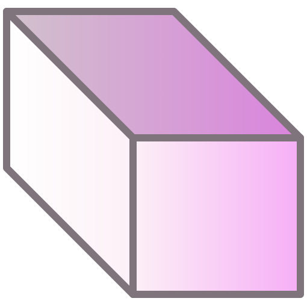
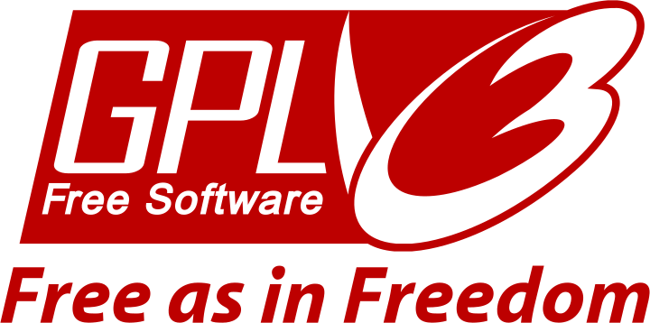

<p align="center"></p>

# YSM Model Tool

English | [简体中文](README.zh-CN.md)

<a href="LICENSE"></a>

Open Yes Steve Model (YSM) player model packs on your computer and preview the model, animations, action-wheel actions, sounds and cover as they appear in the game, and manage a local model library.

Built with Vite 7 + Three.js, with a Material 3 interface. Packaged as a Windows desktop app with Tauri 2 (Rust), and also runs directly in a browser.

## Features

### Model import

- Model folders, ZIP archives (including GBK file names) and encrypted `.ysm` files, imported with the buttons or by drag and drop
- Encrypted `.ysm` files are parsed in a Worker by the WebAssembly build of [YSMParser](https://github.com/OpenYSM/YSMParser); neither the original file nor the decrypted result is written to disk
- A progress bar is shown while importing; no model is loaded at startup
- Double-click a `.ysm` file to open it; a running app opens it in its existing window instead of starting a second copy
- Raw-face rendering mode for encrypted `.ysm` files: draws the face data stored in the file directly, the same data the game uses (switch in the top bar)

### Rendering and animation (behaviour matches ModernYSM)

- Bedrock geometry, box UV, multiple textures, glow layer (ysmGlow), part hiding
- Animation controllers: animation table merging, controller execution order, parallel / pre_parallel slots, state transition blending
- Molang: unset variables, `??`, division by zero, `bone_rot` reading the previous frame, `first_order`, `perlin_noise`, `bone_pos/scale/pivot_abs`, blinking `ysm.is_close_eyes`, head turning
- Animations without `animation_length` are treated as infinitely long; models with many keyframes still play smoothly

### Action wheel, actions and sounds

- extra_animation wheel with categories and buttons, paged with the mouse wheel; model settings (including radio options and one-click outfit changes) are shown as forms
- Export the wheel as an image or a multi-page PDF
- Save the settings of every form of a model in one click and restore them automatically the next time the model loads; export them as a `.json` file to share and import such files
- Sound playback with channels and `play_sound` parameters
- Held-item menu (`hold_<hand>` matching, TaCZ guns)

### Play mode

- After pointer lock, move with WASD; jump, sneak, sprint and fly; the main animation follows the game's state priority
- Elytra gliding (`elytra_fly`, wear an elytra in the player status menu, then press Space in the air) and swimming (X enters / leaves water: `swim_stand`, `swim`)
- F5 switches between first and third person; first person shows the arms (vanilla punch, lowering / raising)
- Alt + left / right click to attack and use, K opens the item panel, and the player status menu changes health, armor, effects, weather and biome
- H shows the key hints, F1 hides the interface

### Cover and export

- The cover card has its own renderer; pick the cover frame live in "Adjust cover"
- Supports `gui_hover` / `gui_focus` controllers and the selection sound, with selected / hover outlines
- Screenshots save the current frame as PNG; covers can be exported as GIF, APNG or MP4
- The cover sidebar can be hidden in Settings; the cover is then not rendered at all

### Model library

- Paging, remembered position, grid / details views, drag-and-drop import
- Rename, set icons, mount into the game with one click; multiple game directories, batch mount and delete
- Press L in the 3D view to quickly switch models
- Windows Explorer shows the library cover as the thumbnail of `.ysm` files (`thumbnail-provider/`, a separate DLL); covers can also be generated for a whole folder

### Interface and visuals

- Material 3 theme with dynamic colors picked from the model texture, light / dark mode
- The app logo takes its colors from the dynamic palette and always stays light
- Lighting (lights, exposure, tone mapping), light level, bloom
- Vertical toolbar on the right (including Unload model) that can slide out of view; full screen for the whole app (F11) or only the 3D view
- Benchmark overlay: frame rate and graph, render statistics, optional uncapped frame rate
- Separate windows: the toolbar (as a horizontal bar) and the cover can each move into their own system window and be dragged outside the main window (Settings → Windows → Separate windows)
- Every window uses the same frameless title bar (minimize / maximize / close); the other windows stay open when the main window is minimized; separate windows and the Molang inspector can be pinned on top
- Model status panel at the top of the 3D view: the current wheel action or main state, a speaker while sound plays, and movement indicators in play mode
- Settings → About: the logo, version, source code link and license

### Model debugging

- Molang inspector: a separate window that shows live values of `v.` / `ctrl.` / `ysm.` / `q.` variables and your own expressions, runs assignments, and has an adjustable opacity (Settings → Model debugging)
- In the inspector: the state of every animation controller with each transition condition's value, per-frame curves of watched expressions, and variable locks that no script can change; an optional setting makes locking `ctrl.<state>` switch the main state

### Interface language

- Simplified Chinese is built in; other languages are external `.lang` files (JSON). English ships with the app
- Switch the language with the language button in the top bar; the interface reloads after switching
- To add a language, copy `lang/en.lang`, edit its `language` info, translate the entries and put the file in the `lang` folder of the app directory. See [`lang/README.md`](lang/README.md)

## Running

Requires Node.js 20.19+ or 22.12+ (24 recommended).

```sh
npm ci
npm run dev        # dev server at http://127.0.0.1:5173 (includes the library dev API)
npm run browser    # same, and opens the browser
npm run build      # web build into dist/
npm run preview    # preview the build
npm run lang       # after changing UI text: sync lang/*.lang (adds new entries, lists untranslated ones)
```

## Windows desktop app

Also requires Rust (MSVC toolchain) and the Microsoft C++ Build Tools; at runtime it needs WebView2 (included in Windows 10/11).

```sh
npm run desktop:dev    # desktop window for development
npm run package        # release build (same as desktop:build)
```

Build output:

- `src-tauri/target/release/ysm-preview.exe`: the program, runs directly
- `src-tauri/target/release/bundle/nsis/YSM模型工具_<version>_x64-setup.exe`: installer (installs for the current user, no administrator rights needed); the bundled language files are installed to `lang/` next to the program

Before releasing a new version, update the version number in `package.json`, `src-tauri/tauri.conf.json` and `src-tauri/Cargo.toml`.

## Project structure

```text
.
├── src/              # page, styles, rendering, animation, Molang, play mode, i18n
│   └── library/      # model library UI and covers
├── public/           # icons, fonts, YSMParser (WASM)
├── lang/             # external language files (en.lang, …)
├── thumbnail-provider/ # Explorer thumbnail DLL for .ysm files (Rust)
├── tools/            # library API for the dev server, language file tools
├── src-tauri/        # Tauri desktop shell (Rust): library file operations, launch options, language folder, packaging
├── index.html
├── vite.config.js
└── package.json
```

## License

Copyright (C) 2026 MioNext

This program is free software: you can redistribute it and/or modify it under the terms of the GNU General Public License as published by the Free Software Foundation, either version 3 of the License, or (at your option) any later version. It is distributed WITHOUT ANY WARRANTY. See [`LICENSE`](LICENSE) for the full text.

The GPLv3 logo (`assets/gplv3-logo.svg`) is by the [Free Software Foundation](https://www.gnu.org/graphics/license-logos.html) and is in the public domain; it is used here only to show this project's license and does not imply endorsement by the FSF.

This is an unofficial community tool and is not affiliated with Yes Steve Model or its authors.

## Credits and licenses

- Rendering implementation references [Blockbench](https://github.com/JannisX11/blockbench) (GPL-3.0-or-later)
- Animation and display behaviour is modelled on how ModernYSM behaves in game, reimplemented independently in JavaScript
- Encrypted YSM parsing: [YSMParser](https://github.com/OpenYSM/YSMParser), license in `public/ysm-parser/LICENSE.txt`
- Rendering: [Three.js](https://threejs.org/); colors: [Material Color Utilities](https://github.com/material-foundation/material-color-utilities)
