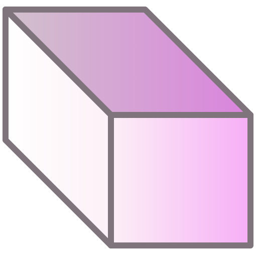
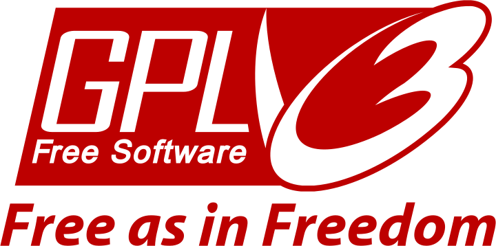

<p align="center"></p>

# YSM模型工具

[English](README.md) | 简体中文

<a href="LICENSE"></a>

在电脑上打开 Yes Steve Model（YSM）玩家模型包，按游戏内的效果预览模型、动画、轮盘动作、声音和封面，并管理本地模型库。

基于 Vite 7 + Three.js，界面遵循 Material 3；通过 Tauri 2（Rust）打包为 Windows 桌面应用，也可以直接在浏览器中运行。

## 功能

### 模型导入

- 支持模型文件夹、ZIP 压缩包（含 GBK 文件名）和加密 `.ysm` 文件，可点击按钮导入，也可直接拖放
- 加密 `.ysm` 由 [YSMParser](https://github.com/OpenYSM/YSMParser) 的 WebAssembly 版本在 Worker 中解析，原文件和解密结果都不会写入磁盘
- 导入时显示进度条；启动时不加载任何模型
- 双击 `.ysm` 文件即可打开；软件已在运行时在原窗口中打开，不会多开
- 加密 `.ysm` 的原始面渲染模式：直接使用文件中与游戏相同的面数据显示（顶栏按钮切换）

### 渲染与动画（行为与 ModernYSM 对齐）

- 基岩版几何体、箱型 UV、多材质、发光图层（ysmGlow）、部件隐藏
- 动画控制器：动画表合并、控制器执行顺序、parallel / pre_parallel 槽位、状态过渡混合
- Molang：未设置变量、`??`、除 0、`bone_rot` 读取上一帧、`first_order`、`perlin_noise`、`bone_pos/scale/pivot_abs`、眨眼 `ysm.is_close_eyes`、头部转动
- 无 `animation_length` 的动画按无限长处理；关键帧很多的模型也能流畅播放

### 轮盘、动作与声音

- extra_animation 轮盘、分类与按钮，支持滚轮翻页；可把模型设置项（含单选项、一键换装）做成表单
- 轮盘导出为图片或分页 PDF
- 一键保存模型所有设置面板的配置，下次加载该模型时自动恢复；可导出为 `.json` 文件分享，也可导入
- 声音播放，支持声道与 `play_sound` 参数
- 手持物品菜单（`hold_<手>` 匹配、TaCZ 持枪）

### 操控模式

- 指针锁定后用 WASD 移动，支持跳跃、潜行、疾跑、飞行，主动作按状态优先级切换
- 鞘翅滑翔（`elytra_fly`，在角色状态里穿上鞘翅，空中按空格）与游泳（X 进入 / 离开水中：`swim_stand`、`swim`）
- F5 切换第一 / 第三人称，第一人称显示手臂（原版挥拳、放下 / 抬起）
- Alt + 左 / 右键攻击与使用，K 打开物品面板，角色状态菜单可调整玩家状态
- H 显示键位提示，F1 隐藏界面

### 封面与导出

- 封面卡片使用独立渲染器，可在“调整封面”中实时选择封面画面
- 支持 `gui_hover` / `gui_focus` 控制器与选中音效，以及选中 / 悬停边框
- 截图保存当前帧 PNG；可导出 GIF、APNG、MP4 动图
- 可在设置中隐藏左侧封面栏，隐藏后封面完全不渲染

### 模型库

- 分页浏览、记住位置、网格 / 详细信息两种视图、拖放导入
- 重命名、设置图标、一键挂载到游戏，支持多个游戏目录、批量挂载与删除
- 3D 视图中按 L 快速切换模型
- Windows 资源管理器中 `.ysm` 文件显示模型库里的封面作为缩略图（`thumbnail-provider/`，单独的 DLL）；也可以为整个文件夹生成

### 界面与画面

- Material 3 主题，可从模型贴图自动取色生成配色，支持浅色 / 深色
- 软件 Logo 随自动取色变色，且始终保持浅色
- 光照调节（光源、曝光、色调）、环境亮度、泛光
- 工具栏在右侧纵向排列（含卸载模型）并可滑出隐藏；可整个应用全屏（F11），也可只全屏 3D 视图
- Benchmark 叠加层：帧率与折线图、渲染统计，可解除帧率上限
- 独立窗口：工具栏（横向）和封面可以放进单独的系统窗口，拖到主窗口外面（设置 → 窗口 → 独立窗口）
- 所有窗口使用统一的无边框标题栏（最小化 / 最大化 / 关闭）；子窗口不随主窗口最小化；独立窗口和 Molang 监视器可以置顶
- 3D 视图顶部的模型状态面板：当前轮盘动作或主状态，有声音时显示扬声器，操控模式中显示移动指示器
- 设置 → 关于：Logo、版本号、开源地址与许可证

### 模型调试

- Molang 监视器：在独立窗口中实时显示 `v.` / `ctrl.` / `ysm.` / `q.` 变量和自定义表达式的值，可执行赋值语句，窗口透明度可调（设置 → 模型调试）
- 监视器中可查看每个动画控制器的状态与各转移条件的值、监视表达式的逐帧曲线，并锁定变量（脚本无法改动）；可选设置让锁定 `ctrl.<状态>` 时同时切换主状态

### 界面语言

- 内置简体中文；其他语言为外置的 `.lang` 语言文件（JSON），随软件附带英文
- 顶栏的语言按钮可切换语言，切换后界面重新载入
- 新增语言：复制 `lang/en.lang`，改写 `language` 信息并逐条翻译，放进软件目录的 `lang` 文件夹即可，说明见 [`lang/README.md`](lang/README.md)

## 运行

需要 Node.js 20.19+ 或 22.12+（推荐 24）。

```sh
npm ci
npm run dev        # 开发服务器 http://127.0.0.1:5173（含模型库开发接口）
npm run browser    # 同上并自动打开浏览器
npm run build      # 网页构建到 dist/
npm run preview    # 预览构建结果
npm run lang       # 修改界面文字后同步 lang/*.lang（新增条目、列出未翻译）
```

## Windows 桌面版

额外需要 Rust（MSVC 工具链）和 Microsoft C++ 生成工具；运行时依赖 WebView2（Windows 10/11 已自带）。

```sh
npm run desktop:dev    # 桌面窗口开发调试
npm run package        # 构建发行版（同 desktop:build）
```

构建产物：

- `src-tauri/target/release/ysm-preview.exe`：可直接运行的程序
- `src-tauri/target/release/bundle/nsis/YSM模型工具_<版本>_x64-setup.exe`：安装包（安装到当前用户，无需管理员权限）

发布新版本前，同步修改 `package.json`、`src-tauri/tauri.conf.json` 和 `src-tauri/Cargo.toml` 中的版本号。

## 目录结构

```text
.
├── src/              # 页面、样式、渲染、动画、Molang、操控模式
│   └── library/      # 模型库界面与封面
├── public/           # 图标、字体、YSMParser（WASM）
├── lang/             # 外置语言文件（en.lang 等）
├── thumbnail-provider/ # .ysm 资源管理器缩略图 DLL（Rust）
├── tools/            # 开发服务器使用的模型库接口、语言文件工具
├── src-tauri/        # Tauri 桌面壳（Rust）：模型库文件操作、启动参数、打包配置
├── index.html
├── vite.config.js
└── package.json
```

## 许可证

Copyright (C) 2026 MioNext

本程序是自由软件：你可以依据自由软件基金会发布的 GNU 通用公共许可证（GPL）第 3 版或（由你选择）任何更新的版本，重新分发和/或修改本程序。本程序不提供任何担保。完整条款见 [`LICENSE`](LICENSE)。

GPLv3 标志（`assets/gplv3-logo.svg`）来自[自由软件基金会](https://www.gnu.org/graphics/license-logos.html)，属公有领域；此处仅用于标明本项目的许可证，不代表获得 FSF 认可。

本项目为非官方社区工具，与 Yes Steve Model 及其作者无关。

## 致谢与许可

- 渲染实现参考 [Blockbench](https://github.com/JannisX11/blockbench)（GPL-3.0-or-later）
- 动画与显示效果以 ModernYSM 在游戏中的行为为依据，用 JavaScript 独立重新实现
- 加密 YSM 解析：[YSMParser](https://github.com/OpenYSM/YSMParser)，许可证见 `public/ysm-parser/LICENSE.txt`
- 渲染：[Three.js](https://threejs.org/)；配色：[Material Color Utilities](https://github.com/material-foundation/material-color-utilities)
